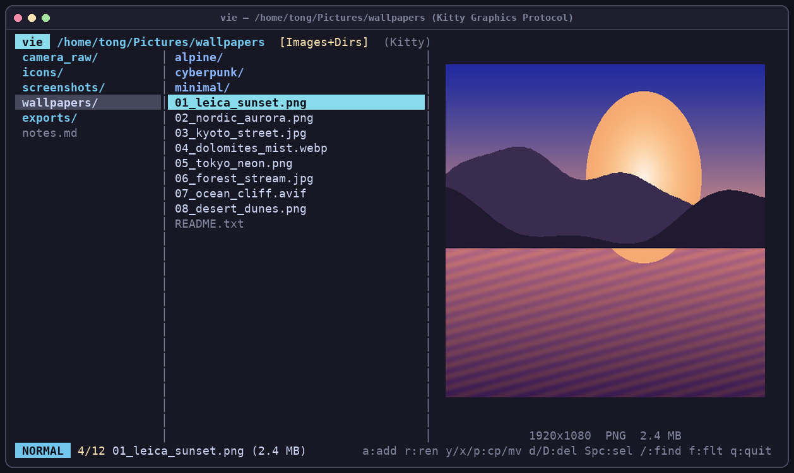
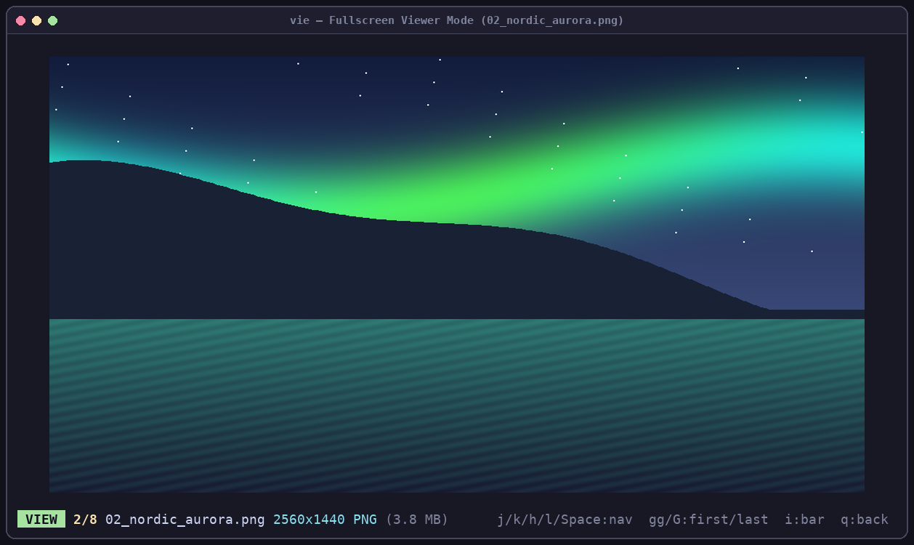
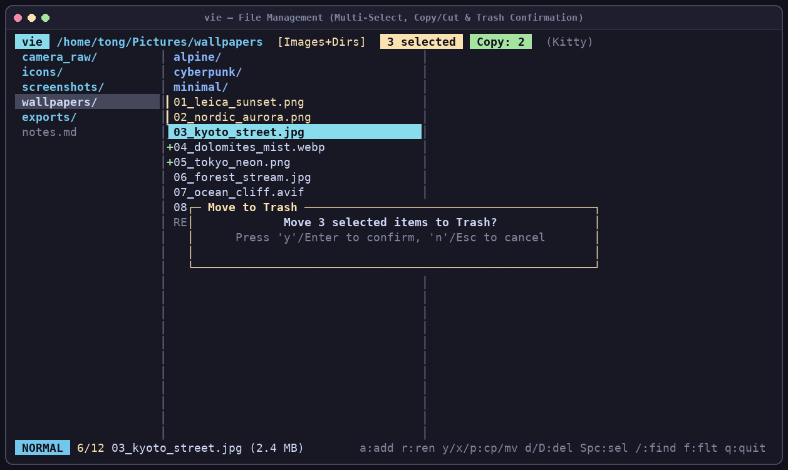
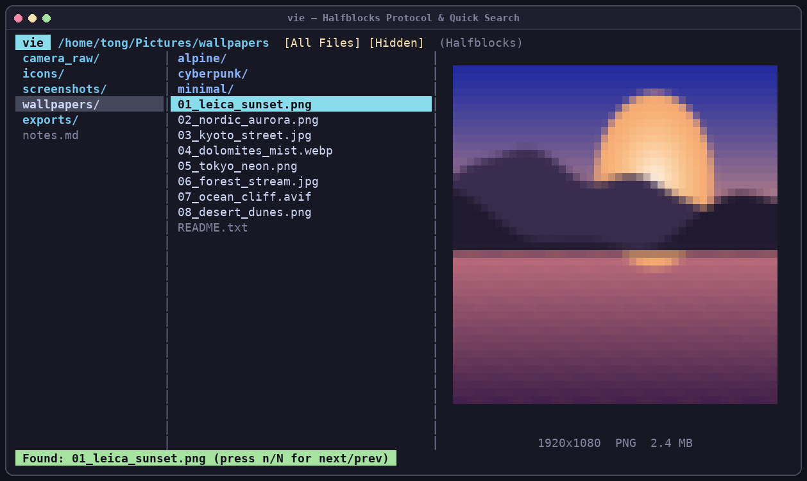

# vie 🖼️

> **EN:** Fast Yazi-style terminal image viewer and file manager written in Rust (supports Ghostty/Kitty, Foot/Sixel, iTerm2, Halfblocks).  
> **TH:** โปรแกรมดูรูปภาพและจัดการไฟล์บน Terminal สไตล์ Yazi ความเร็วสูง เขียนด้วยภาษา Rust (รองรับ Ghostty/Kitty, Foot/Sixel, iTerm2, Halfblocks)

---

## 📸 Screenshots / ภาพตัวอย่างการใช้งาน

### 1. 3-Column Browser Mode & Live Image Preview (โหมดสำรวจไฟล์ 3 คอลัมน์พร้อมพรีวิวรูปภาพ)


### 2. Fullscreen Image Viewer Mode (โหมดดูรูปภาพเต็มหน้าจอ)


### 3. Yazi-Style File Management: Multi-Select, Copy/Cut & Trash (การเลือกหลายไฟล์ คัดลอก/ตัด และย้ายลงถังขยะ)


### 4. Quick Search, Filter Modes & Halfblocks Fallback (การค้นหา กรองไฟล์ และโหมด Halfblocks สำหรับ Terminal ทั่วไป)


---

## 🇬🇧 English

### Overview
**vie** is a lightweight, fast terminal user interface (TUI) image viewer and file manager inspired by [Yazi](https://github.com/sxyazi/yazi) and Vim keybindings. Built with Rust, `ratatui`, and `ratatui-image`, it provides smooth, non-blocking image previews directly inside modern terminals.

### Features
- **Dual-Mode Interface:**
  - **Browser Mode:** 3-column Yazi-style directory browser (shows all files by default) with live image preview, text file preview with line numbers, and image metadata.
  - **Fullscreen Viewer Mode:** Distraction-free fullscreen image viewing with quick next/prev navigation and toggleable status bar.
- **Text Editing & In-Terminal Media Playback:**
  - **Text Files:** Live text preview in the right column; press `Enter` (`l` / `→`) to open the file in `vi` and return directly to `vie` when exiting `vi`.
  - **Audio & Video (`.mp3`, `.mp4`, etc.):** Press `Enter` (`l` / `→`) to play audio or video directly inside the terminal screen (`q` / `Esc` stops playback and returns to the browser).
- **Multi-Protocol Terminal Graphics:**
  - Automatically detects the best supported graphics protocol (`Kitty` / `Ghostty`, `Sixel` / `Foot`, `iTerm2`, or `Halfblocks` fallback), or lets you force one via `--protocol`.
- **Asynchronous Image Engine:**
  - Background worker thread for image decoding and resizing, LRU caching, and automatic preloading of adjacent images for instant navigation.
- **Yazi-Style File Management:**
  - Multi-file selection, Copy (`y`), Cut (`x`), Paste (`p`/`P`), Create file or folder (`a`), Rename (`r`), Move to OS Trash (`d`), Permanent Delete (`D`), Search (`/`), and Image-only filter (`f`).
- **Yazi-Style Sorting & 3-Level Search:**
  - **Sort Menu (`,`):** `,n/N` (Natural), `,a/A` (Alphabetical), `,m/M` (Modified time), `,s/S` (Size), `,e/E` (Extension), `,d` (toggle Dirs-first) with an on-screen which-key hint bar.
  - **Smart-Case Find (`/` / `?` + `n` / `N`):** Jump forward/backward to matching items in the current directory with match counter (`Match 2/5`).
  - **Live Name Filter (`f`):** Filter the current directory in real time as you type (`Esc` clears filter).
  - **Recursive Search (`s`):** Search files across all subdirectories and jump straight to the selected file.

### Supported Image Formats
`jpg`, `jpeg`, `png`, `webp`, `gif`, `bmp`, `ico`, `tiff`, `tif`, `pnm`, `pbm`, `pgm`, `ppm`, `tga`, `dds`, `farbfeld`, `exr`, `hdr`, `qoi`, `avif`

### Installation

#### Option 1: Download Prebuilt Binary (No Rust required)
Download the latest prebuilt binary for your OS (Linux, macOS, Windows) from the [**GitHub Releases**](https://github.com/acith/vie/releases) page:

```bash
# Example for Linux (x86_64 static binary)
tar -xzf vie-v0.12-x86_64-unknown-linux-musl.tar.gz
chmod +x vie
sudo mv vie /usr/local/bin/
```

#### Option 2: Build from Source (Cargo)
```bash
git clone https://github.com/acith/vie.git
cd vie
cargo install --path .
```

Make sure `~/.cargo/bin` is in your `PATH`.

### Usage

```bash
# Show current version and exit
vie --version

# Open current directory
vie

# Open a specific directory or image file (opens directly in fullscreen viewer if an image file is passed)
vie /path/to/photos
vie /path/to/image.png

# Force a specific graphics protocol (auto, kitty, sixel, iterm2, halfblocks)
vie --protocol kitty
vie -p sixel /path/to/photos
```

### Keybindings

#### Browser Mode
| Key | Action |
| :--- | :--- |
| `j` / `↓` | Move cursor down |
| `k` / `↑` | Move cursor up |
| `Ctrl+d` / `PageDown` | Scroll down 15 items |
| `Ctrl+u` / `PageUp` | Scroll up 15 items |
| `gg` / `Home` | Jump to top |
| `G` / `End` | Jump to bottom |
| `h` / `←` / `Backspace` | Go to parent directory |
| `l` / `→` / `Enter` | Enter directory, open image in Fullscreen Viewer, edit text file in `vi`, or play audio/video in terminal |
| `,` + `n/N`, `a/A`, `m/M`, `s/S`, `e/E`, `d` | Yazi-style Sort menu (Natural, Alpha, Modified, Size, Extension, toggle Dirs-first) |
| `f` | Live name filter in current directory (`Esc` to clear) |
| `t` | Cycle file type filter (**All Files** / **Dirs+Images** / **Dirs Only**) |
| `/` / `?` | Smart-case find forward / backward in current directory |
| `n` / `N` | Jump to next / previous find match |
| `s` | Recursive search across subdirectories (`↑`/`↓` to select, `Enter` to jump) |
| `.` | Toggle hidden files (dotfiles) |
| `Space` | Toggle selection on current item and move down |
| `Ctrl+a` | Select all items |
| `Ctrl+r` | Invert selection |
| `Esc` | Clear active name filter, or clear selection and clipboard |
| `y` | Yank (Copy) selected/hovered item(s) |
| `x` | Cut selected/hovered item(s) |
| `p` / `P` | Paste (`p` auto-renames on conflict, `P` overwrites) |
| `a` | Create new file or directory (end with `/` to create directory) |
| `r` | Rename currently hovered item |
| `d` | Move selected/hovered item(s) to OS Trash |
| `D` | Permanently delete selected/hovered item(s) |
| `q` / `Ctrl+c` | Quit |

#### Fullscreen Viewer Mode
| Key | Action |
| :--- | :--- |
| `j` / `l` / `↓` / `→` / `Space` / `PageDown` | Next image |
| `k` / `h` / `↑` / `←` / `Backspace` / `PageUp` | Previous image |
| `gg` / `Home` | First image in directory |
| `G` / `End` | Last image in directory |
| `i` | Toggle bottom info bar |
| `q` / `Esc` | Return to Browser Mode |
| `Ctrl+c` | Quit application |

---

## 🇹🇭 ภาษาไทย

### ภาพรวม
**vie** คือโปรแกรมดูรูปภาพและจัดการไฟล์บน Terminal (TUI) ที่เน้นความเร็วและน้ำหนักเบา ได้รับแรงบันดาลใจจาก [Yazi](https://github.com/sxyazi/yazi) และปุ่มควบคุมแบบ Vim พัฒนาด้วยภาษา Rust ร่วมกับ `ratatui` และ `ratatui-image` ช่วยให้สามารถพรีวิวรูปภาพความละเอียดสูงบน Terminal สมัยใหม่ได้อย่างลื่นไหลโดยไม่ทำให้หน้าจอค้าง

### คุณสมบัติเด่น (Features)
- **การทำงาน 2 โหมด:**
  - **Browser Mode:** หน้าจอ 3 คอลัมน์สไตล์ Yazi (แสดงไฟล์ทั้งหมดเป็นค่าเริ่มต้น) พร้อมพรีวิวรูปภาพ พรีวิวเนื้อหาไฟล์ข้อความ (Text Preview) และข้อมูลขนาดภาพฝั่งขวา
  - **Fullscreen Viewer Mode:** โหมดดูรูปภาพเต็มหน้าจอ เลื่อนดูรูปถัดไป/ก่อนหน้าได้รวดเร็ว พร้อมซ่อน/แสดงแถบสถานะได้ (`i`)
- **แก้ไขไฟล์ Text ด้วย `vi` และเล่นไฟล์ `.mp3` / `.mp4` ใน Terminal:**
  - **Text File:** แสดงพรีวิวข้อความในคอลัมน์ขวา และกด `Enter` (`l` / `→`) เพื่อเปิดแก้ไขไฟล์ด้วย `vi` ทันที เมื่อออกจาก `vi` จะกลับเข้าหน้าจอ Explorer ของ `vie` เหมือนเดิม
  - **ไฟล์เสียงและวิดีโอ (`.mp3`, `.mp4` ฯลฯ):** กด `Enter` (`l` / `→`) เพื่อเล่นเสียงหรือวิดีโอภายในหน้าจอ Terminal โดยตรง (กด `q` / `Esc` เพื่อหยุดเล่นแล้วกลับสู่หน้า Explorer)
- **รองรับโปรโตคอลกราฟิกบน Terminal ครบครัน:**
  - ตรวจจับโปรโตคอลอัตโนมัติ (`Kitty` / `Ghostty`, `Sixel` / `Foot`, `iTerm2`, หรือ `Halfblocks`) และสามารถระบุบังคับผ่าน `--protocol` ได้
- **ระบบโหลดรูปภาพแบบ Asynchronous:**
  - ประมวลผลและย่อขนาดภาพใน Background Thread พร้อมระบบ LRU Cache และ Preload รูปข้างเคียงล่วงหน้า ทำให้เปิดสลับรูปได้ทันที
- **จัดการไฟล์ครบเครื่องสไตล์ Yazi:**
  - รองรับการเลือกหลายไฟล์ (`Space`), คัดลอก (`y`), ตัด (`x`), วาง (`p`/`P`), สร้างไฟล์หรือโฟลเดอร์ใหม่ (`a`), เปลี่ยนชื่อ (`r`), ทิ้งลงถังขยะ (`d`), ลบถาวร (`D`), ค้นหาชื่อไฟล์ (`/`) และสลับกรองเฉพาะไฟล์รูปภาพ (`f`)
- **ระบบ Sorting และค้นหา 3 ระดับสไตล์ Yazi:**
  - **เมนูเรียงลำดับ (`,`):** `,n/N` (Natural), `,a/A` (Alphabetical), `,m/M` (เวลาแก้ไข), `,s/S` (ขนาดไฟล์), `,e/E` (นามสกุลไฟล์), `,d` (สลับโฟลเดอร์ขึ้นก่อน) พร้อมแถบคำใบ้ด้านล่าง
  - **ค้นหาในโฟลเดอร์ (`/` / `?` + `n` / `N`):** ค้นหาแบบ Smart-case พร้อมแสดงลำดับที่พบ (`Match 2/5`)
  - **กรองชื่อไฟล์แบบ Real-time (`f`):** พิมพ์เพื่อกรองรายการในโฟลเดอร์ปัจจุบันทันที (กด `Esc` เพื่อล้าง Filter)
  - **ค้นหาข้ามโฟลเดอร์ย่อย (`s`):** ค้นหาไฟล์ทุกชั้นในโฟลเดอร์ย่อย แล้วกด `Enter` กระโดดไปที่ไฟล์นั้นทันที

### การติดตั้ง (Installation)

#### วิธีที่ 1: ดาวน์โหลดไฟล์ Binary สำเร็จรูป (ไม่ต้องติดตั้ง Rust หรือ Build เอง)
สามารถดาวน์โหลดไฟล์ที่คอมไพล์เสร็จแล้วสำหรับ Linux, macOS และ Windows ได้ที่หน้า [**GitHub Releases**](https://github.com/acith/vie/releases):

```bash
# ตัวอย่างสำหรับ Linux (x86_64 Static Binary รันได้ทุก Distro)
tar -xzf vie-v0.12-x86_64-unknown-linux-musl.tar.gz
chmod +x vie
sudo mv vie /usr/local/bin/
```

#### วิธีที่ 2: Build จาก Source Code ด้วย Cargo
```bash
git clone https://github.com/acith/vie.git
cd vie
cargo install --path .
```

*(ตรวจสอบให้แน่ใจว่าได้เพิ่ม `~/.cargo/bin` ไว้ใน `PATH` ของระบบแล้ว)*

### การใช้งาน (Usage)

```bash
# ตรวจสอบเวอร์ชันปัจจุบันของโปรแกรม
vie --version

# เปิดโฟลเดอร์ปัจจุบัน
vie

# เปิดโฟลเดอร์หรือไฟล์รูปภาพที่ต้องการ (หากระบุเป็นไฟล์รูปภาพ จะเปิดเข้าโหมดเต็มจอทันที)
vie /path/to/photos
vie /path/to/image.png

# บังคับเลือกโปรโตคอลแสดงผลรูปภาพ (auto, kitty, sixel, iterm2, halfblocks)
vie --protocol kitty
vie -p sixel /path/to/photos
```

### ปุ่มลัด (Keybindings)

#### โหมดสำรวจไฟล์ (Browser Mode)
| ปุ่มกด | การทำงาน |
| :--- | :--- |
| `j` / `↓` | เลื่อนลง 1 รายการ |
| `k` / `↑` | เลื่อนขึ้น 1 รายการ |
| `Ctrl+d` / `PageDown` | เลื่อนลงทีละ 15 รายการ |
| `Ctrl+u` / `PageUp` | เลื่อนขึ้นทีละ 15 รายการ |
| `gg` / `Home` | ไปยังรายการแรกสุด |
| `G` / `End` | ไปยังรายการสุดท้าย |
| `h` / `←` / `Backspace` | ย้อนกลับไปยังโฟลเดอร์แม่ (Parent Directory) |
| `l` / `→` / `Enter` | เข้าโฟลเดอร์, ดูรูปเต็มจอ, แก้ไขไฟล์ Text ด้วย `vi`, หรือเล่น `.mp3`/`.mp4` ใน Terminal |
| `,` + `n/N`, `a/A`, `m/M`, `s/S`, `e/E`, `d` | เมนูเรียงลำดับสไตล์ Yazi (Natural, Alpha, Modified, Size, Ext, สลับ Dirs-first) |
| `f` | กรองชื่อไฟล์แบบ Real-time ในโฟลเดอร์ปัจจุบัน (กด `Esc` เพื่อล้าง) |
| `t` | สลับประเภทไฟล์ที่แสดง (**All Files** / **Dirs+Images** / **Dirs Only**) |
| `/` / `?` | ค้นหาไฟล์ไปข้างหน้า / ย้อนกลับในโฟลเดอร์ปัจจุบัน (Smart-case) |
| `n` / `N` | ไปยังผลการค้นหาถัดไป / ก่อนหน้า |
| `s` | ค้นหาไฟล์ข้ามโฟลเดอร์ย่อยทั้งหมด (`↑`/`↓` เลือก, `Enter` กระโดดไปที่ไฟล์) |
| `.` | แสดง / ซ่อนไฟล์ที่ซ่อนอยู่ (Hidden files) |
| `Space` | เลือก/ยกเลิกการเลือกไฟล์ แล้วเลื่อนลง |
| `Ctrl+a` | เลือกไฟล์ทั้งหมดในโฟลเดอร์ |
| `Ctrl+r` | สลับรายการที่เลือก (Invert selection) |
| `Esc` | ล้างตัวกรองชื่อไฟล์ หรือล้างรายการที่เลือกและ Clipboard |
| `y` | คัดลอกไฟล์ที่เลือก (Copy) |
| `x` | ตัดไฟล์ที่เลือกเพื่อย้าย (Cut) |
| `p` / `P` | วางไฟล์ (`p` เปลี่ยนชื่ออัตโนมัติถ้าชื่อซ้ำ, `P` เขียนทับไฟล์เดิม) |
| `a` | สร้างไฟล์หรือโฟลเดอร์ใหม่ (ลงท้ายด้วย `/` เพื่อสร้างโฟลเดอร์) |
| `r` | เปลี่ยนชื่อไฟล์หรือโฟลเดอร์ปัจจุบัน |
| `d` | ย้ายไฟล์ที่เลือกไปไว้ในถังขยะของระบบ (Trash) |
| `D` | ลบไฟล์ที่เลือกแบบถาวร (Permanent Delete) |
| `q` / `Ctrl+c` | ออกจากโปรแกรม |

#### โหมดดูรูปเต็มจอ (Fullscreen Viewer Mode)
| ปุ่มกด | การทำงาน |
| :--- | :--- |
| `j` / `l` / `↓` / `→` / `Space` / `PageDown` | ดูรูปถัดไป |
| `k` / `h` / `↑` / `←` / `Backspace` / `PageUp` | ดูรูปก่อนหน้า |
| `gg` / `Home` | ไปยังรูปแรกสุดในโฟลเดอร์ |
| `G` / `End` | ไปยังรูปสุดท้ายในโฟลเดอร์ |
| `i` | แสดง / ซ่อนแถบข้อมูลด้านล่าง |
| `q` / `Esc` | กลับไปยังโหมดสำรวจไฟล์ (Browser Mode) |
| `Ctrl+c` | ออกจากโปรแกรม |
